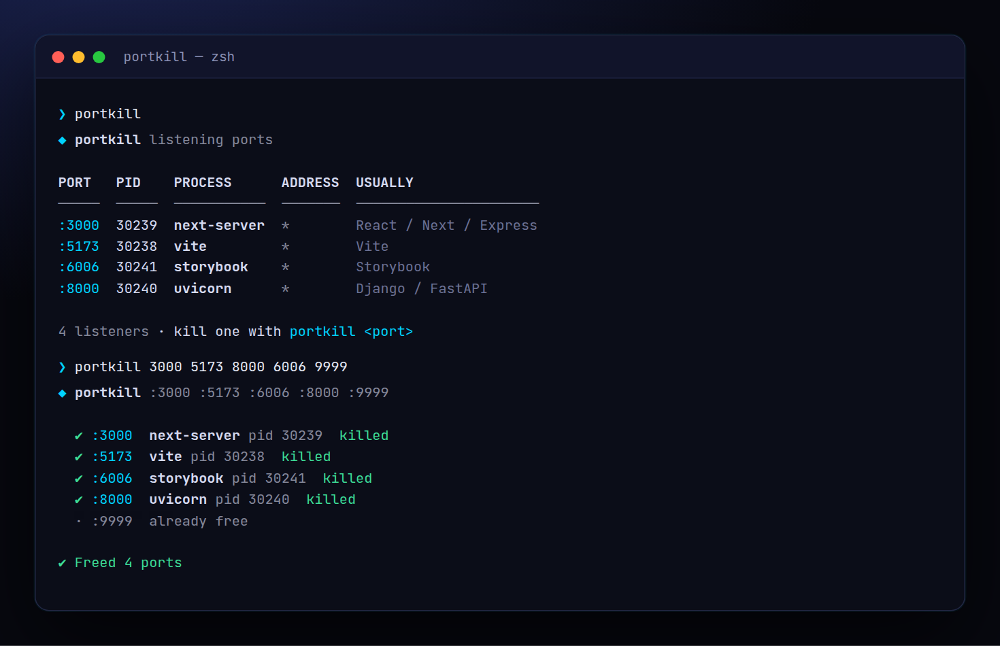

<!-- ═════════════ HEADER ═════════════ -->
<p align="center">
  
</p>

<p align="center">
  
</p>

<p align="center">
  <a href="https://github.com/krishyaa06/prism-port-killer/actions/workflows/ci.yml"></a>
  
  
  <a href="LICENSE"></a>
</p>

<p align="center">
  
</p>


## ⚡ Overview

**Prism Port Killer** (`portkill`) fixes the most annoying error in web dev: `EADDRINUSE: address already in use :::3000`. Run it with no arguments to see every listening port with its process and what usually runs there, or pass ports / ranges to free them. It sends `SIGTERM` first so servers can shut down cleanly, then `SIGKILL` if they don't exit within 3 seconds.

## ✨ Features

- `portkill` lists every listening TCP port with PID, process name and a hint (Vite, Next, Postgres…)
- Kill by port, several ports, or ranges: `portkill 3000 5173 8000-8010`
- `--dev` preset frees all common dev-server ports at once
- Graceful: `SIGTERM` → wait → `SIGKILL`; `--force` to kill immediately
- `--dry-run` and `--json`; exit code 1 if a port could not be freed
- Works on **macOS / Linux** (lsof or ss) and **Windows** (netstat + taskkill). Zero dependencies

## 🚀 Quick Start

```bash
# run without installing
npx github:krishyaa06/prism-port-killer 3000

# or install globally
npm install -g github:krishyaa06/prism-port-killer
portkill --dev
```

Requires Node.js 18.17+. No dependencies.

## 🛠️ Usage

```text
portkill                     list every listening port
portkill 3000                kill whatever is on :3000
portkill 3000 5173 8080      several at once
portkill 3000-3010           a range
portkill --dev               kill common dev-server ports

  -f, --force      SIGKILL immediately
  -n, --dry-run    show what would be killed
      --json       machine-readable output
```

### Try it safely

```bash
node examples/dev-servers.js   # starts fake vite / next / uvicorn / storybook servers
portkill                       # see them
portkill --dev 6006            # free them all
```

### Add it to your scripts

```json
"scripts": { "predev": "npx --yes github:krishyaa06/prism-port-killer 3000" }
```

> Ports owned by another user (e.g. system services) need `sudo`.

## 📁 Project Structure

```
prism-port-killer/
├── assets/
│   ├── logo.png
│   └── logo.svg
├── bin/
│   └── portkill.js   # CLI entry
├── examples/
│   └── dev-servers.js   # fake servers to try it on
├── src/
│   ├── index.js   # port discovery + kill
│   └── ui.js   # colours, tables
├── test/
│   └── portkill.test.js
├── .gitignore
├── LICENSE
└── package.json
```

## 🧪 Tests

```bash
npm test
```

Tests use the built-in `node:test` runner, so there is nothing to install. CI runs them on Node 20 and 22.

## 🤝 Contributing

1. Fork the repo and create a branch: `git checkout -b feature/my-idea`
2. Make your change and add a test in `test/`
3. Run `npm test` and open a Pull Request

## 🔷 Part of Prism Protocol

Prism Port Killer is one of the open-source tools built by [Prism Protocol](https://dc.gg/prismprotocol), a tech community where young builders learn, ship and compete together.

## 👤 Author

<table>
  <tr>
    <td align="center">
      <a href="https://github.com/krishyaa06"><br><b>Soumya Bhandare</b></a><br>
      <sub>Founder @ Prism Protocol</sub>
    </td>
    <td>
      <a href="https://dc.gg/prismprotocol"></a><br>
      <a href="https://instagram.com/prism_protocol_"></a><br>
      <a href="https://x.com/krishyaa06"></a>
    </td>
  </tr>
</table>

## 📄 License

Released under the [MIT License](LICENSE).

<p align="center">
  <b>If you like this project, consider giving it a ⭐</b><br>
  <sub>"Build. Create. Compete." · Made with ⚡ by Prism Protocol</sub>
</p>


